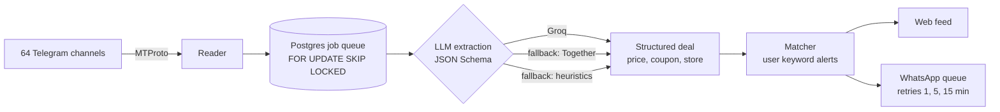

<a href="https://www.linkedin.com/in/sammyferreira1/"><picture><source media="(prefers-color-scheme: dark)" srcset="./profile/top-dark.svg"></picture></a>

<a href="https://pingo.nortyra.com.br"><picture><source media="(prefers-color-scheme: dark)" srcset="./profile/pingo-dark.svg"></picture></a><a href="https://candidato.nortyra.com.br"><picture><source media="(prefers-color-scheme: dark)" srcset="./profile/candidato-dark.svg"></picture></a>

<picture><source media="(prefers-color-scheme: dark)" srcset="./profile/soin-dark.svg"></picture><picture><source media="(prefers-color-scheme: dark)" srcset="./profile/creators-dark.svg"></picture>

<picture><source media="(prefers-color-scheme: dark)" srcset="./profile/bottom-dark.svg"></picture>

  
  
  

<b>How Pingo turns a Telegram message into a WhatsApp alert</b>

 

Retries are classified by error type, the queue survives WhatsApp session drops, and nothing depends on a single LLM provider.

<b>How I ship with AI agents</b>

 

- I write the spec first: inputs, outputs, edge cases and what failure looks like.
- Agents implement in small units, and each unit gets a review pass before it merges.
- Numbers that matter are computed in code, never left for the model to guess.
- Tests are the contract. On SOIN that meant about 700 of them in four days.

<b>Things I like in production</b>

 

- Postgres doing real work: job queues with `SKIP LOCKED`, advisory locks, window functions
- Money flows that survive bad days: idempotency keys, webhooks plus polling, reconciliation
- LLMs with guardrails: structured output, validation in the backend, provider fallbacks, evals

