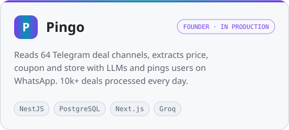
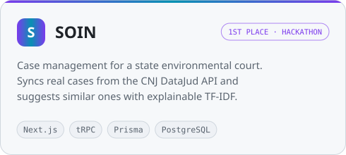
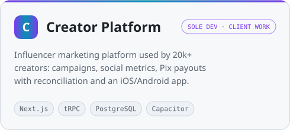
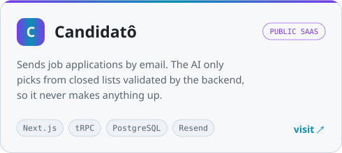
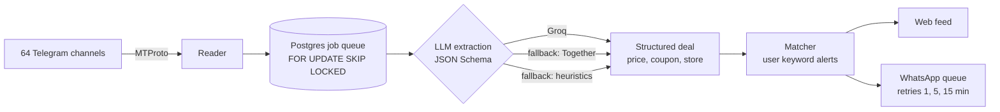

<a href="https://www.linkedin.com/in/sammyferreira1/">
  <picture>
    <source media="(prefers-color-scheme: dark)" srcset="./assets/header-dark.svg">
    
  </picture>
</a>

  
  
  

I build products that use AI and handle money, and I care about the parts that keep them correct in production: validation, queues, idempotency and tests. Most of my work lives in private client repos, so here is the short version.

<picture>
  <source media="(prefers-color-scheme: dark)" srcset="./assets/highlights-dark.svg">
  
</picture>

## Featured work

  <picture>
    <source media="(prefers-color-scheme: dark)" srcset="./assets/project-pingo-dark.svg">
    
  </picture>
  <picture>
    <source media="(prefers-color-scheme: dark)" srcset="./assets/project-soin-dark.svg">
    
  </picture>
  <picture>
    <source media="(prefers-color-scheme: dark)" srcset="./assets/project-creators-dark.svg">
    
  </picture>
  <a href="https://candidato.nortyra.com.br">
    <picture>
      <source media="(prefers-color-scheme: dark)" srcset="./assets/project-candidato-dark.svg">
      
    </picture>
  </a>

<b>How Pingo turns a Telegram message into a WhatsApp alert</b>

 

Retries are classified by error type, the queue survives WhatsApp session drops, and nothing depends on a single LLM provider.

<b>How I ship with AI agents</b>

 

- I write the spec first: inputs, outputs, edge cases and what failure looks like.
- Agents implement in small units, and each unit gets a review pass before it merges.
- Numbers that matter are computed in code, never left for the model to guess.
- Tests are the contract. On SOIN that meant about 700 of them in four days.

<b>Things I like in production</b>

 

- Postgres doing real work: job queues with `SKIP LOCKED`, advisory locks, window functions
- Money flows that survive bad days: idempotency keys, webhooks plus polling, reconciliation
- LLMs with guardrails: structured output, validation in the backend, provider fallbacks, evals

## Stack

<picture>
  <source media="(prefers-color-scheme: dark)" srcset="./assets/stack-dark.svg">
  
</picture>

## Activity

  <picture>
    <source media="(prefers-color-scheme: dark)" srcset="./profile/stats-dark.svg">
    
  </picture>
  <picture>
    <source media="(prefers-color-scheme: dark)" srcset="./profile/top-langs-dark.svg">
    
  </picture>

  <picture>
    <source media="(prefers-color-scheme: dark)" srcset="./profile/streak-dark.svg">
    
  </picture>

<picture>
  <source media="(prefers-color-scheme: dark)" srcset="./profile/snake-dark.svg">
  
</picture>

<picture>
  <source media="(prefers-color-scheme: dark)" srcset="./assets/footer-dark.svg">
  
</picture>
